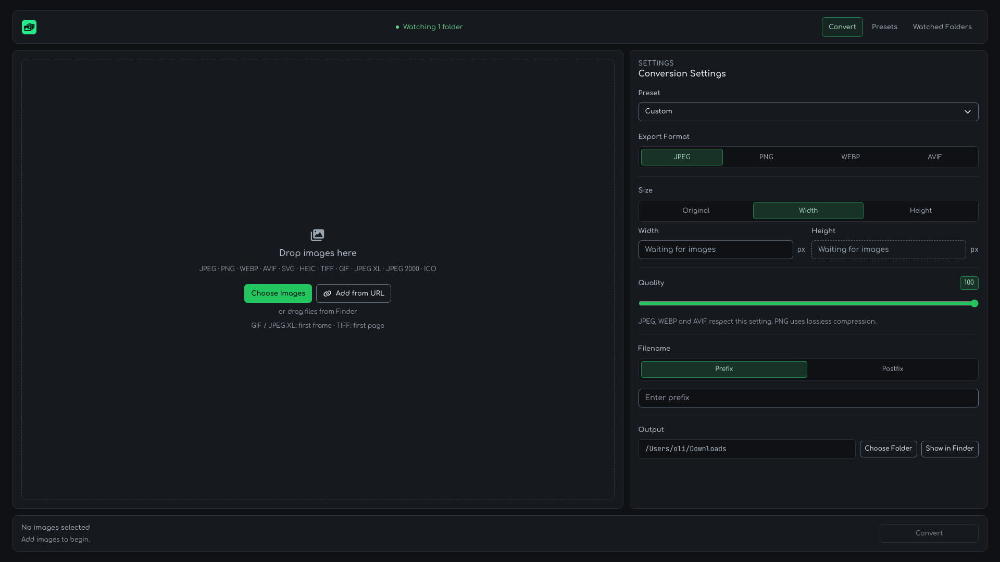

# BulkPixel 🖼️


**Convert more. Click less.**

BulkPixel is a local-first desktop app for fast batch image processing (Mac Only).  
Drop in multiple images, choose an output format, resize if needed, and export everything in one go.

Built for people who do not want a bloated image editor just to prepare assets for the web, blogs, apps, client work, or side projects.



## Why BulkPixel

Most image tools are either too heavy, too online, or too annoying for simple repetitive work.

BulkPixel focuses on the practical stuff:

- batch convert images in seconds
- resize without breaking aspect ratios
- export to modern web-friendly formats
- keep filenames predictable
- avoid accidental overwrites
- see honest file savings after conversion

It is local-first, fast, and intentionally restrained.

## Features

### Available now

- Drag and drop images into the app
- Native file picker support
- Import original images from public HTTP/HTTPS image or website URLs, including clipboard paste, batch downloads, progress, cancel, and retry
- Browser image context menu **Send to BulkPixel** through the bundled Chrome/Chromium/Brave/Edge extension ([setup](docs/BROWSER.md))
- macOS Dock menu shortcuts for Convert, Presets, and Watched Folders
- Batch conversion for multiple images at once
- Input support for `jpg`, `jpeg`, `png`, `avif`, `webp`, `svg`, `heic`, `heif`, `tif`, `tiff`, `gif`, `jxl` (JPEG XL), `jp2` (JPEG 2000), and `ico`
- Export to `jpg`, `png`, `avif` or `webp`
- Resize by width or height
- Automatic aspect-ratio preservation
- Quality control for JPEG, WEBP and AVIF
- Lossless PNG encoding that preserves 16-bit source channels, including when resizing
- Optional filename prefix or postfix (toggle between modes)
- Output folder selection
- Presets for saving reusable conversion settings
- Watched Folders for automatically running presets when new JPEG, PNG, WEBP, AVIF, SVG, HEIC, TIFF, GIF, JPEG XL, JPEG 2000, or ICO files arrive
- Terminal CLI for scripted conversion, preset and Watched Folder management, and statistics
- Collision-safe saving with `_1`, `_2`, and so on
- Per-image and total savings analysis
- Clear success, partial-success, and error feedback

See the [supported import and export formats](docs/FORMATS.md) for the complete compatibility matrix and format-specific behavior.

## Import from URLs

Click **Add from URL** beside **Choose Images**, or in the image list toolbar, and paste one image or website URL per line. On macOS, **Cmd+V** outside an editable field opens the same dialog with clipboard URLs; downloads start only after clicking **Import Images**.

URLs ending in a supported image extension (case-insensitive, ignoring query strings and fragments) download directly without running Fetchary. Other URLs are checked for image content first; website responses are parsed locally with Fetchary's [`extractImages`](https://github.com/oliverjessner/fetchary/blob/main/docs/LIBRARY.md). All discovered image URLs are downloaded into the existing queue, with duplicates removed across the import. Discovery includes image tags, `srcset`/picture sources, lazy-loading attributes, metadata images, image links, and inline CSS backgrounds. JavaScript is not executed, and external stylesheets are not scanned. Node.js and Fetchary are bundled with the app; users do not need to install either.

Downloads appear in the existing image queue and use the same previews, presets, resizing, quality, filenames, and export settings as local files. Failed downloads can be retried while successful imports remain loaded. URLs without file extensions and image responses with incorrect Content-Type headers are supported through content detection.

The default limit is 50 MB per image, configurable from 1–200 MB in the dialog, with a 30-second timeout per source and at most five redirects. Enter up to 100 source URLs per import; discovered images can exceed that count. Websites are limited to 20 MB (or the selected download limit when smaller), 10,000 image URLs, and a 16 MB extracted URL list; exceeding a limit reports an error. Only public HTTP/HTTPS destinations are allowed, including extracted images. URL-imported SVGs must be self-contained. Temporary originals are removed when an imported image is removed from the queue or the app exits; abandoned sessions are cleaned up on the next URL import. No proxy or third-party download service is used.

The CLI supports the same importer with `bulkpixel convert --url <url...>` and `--url-max-mb`; see [CLI documentation](docs/CLI.md#import-from-urls).

Images imported from [oliverjessner.at](https://oliverjessner.at):


## Image Inspector

Open Image Info for any loaded image to inspect its dimensions, format, color information, embedded metadata, and privacy-relevant fields without leaving the conversion workflow.


## Presets

Presets let you save complete conversion setups and reuse them later.  
A preset stores the export format, resize setting, quality, filename prefix or postfix, and output folder.

Use `Convert` for normal batch conversion. Use `Presets` to create, edit, duplicate, or delete saved setups. In the conversion settings, the preset dropdown lets you switch between `Default`, saved presets, and `Custom` when settings are changed manually.


## Watched Folders

Watched Folders monitor selected folders while BulkPixel is running. Give each rule a name, choose one or more input formats and presets, and BulkPixel automatically applies those presets when a matching file arrives directly in the folder.

Rules are stored alongside presets and statistics in BulkPixel's shared SQLite database. If a rule writes a supported format directly into another enabled Watched Folder, BulkPixel continues the conversion there automatically. Native file events are deduplicated, repeated rules stop the current chain, and every chain is limited to eight rules to prevent conversion loops. When multiple presets are selected, each preset must use a unique non-empty prefix or postfix.


## Statistics

Click the BulkPixel brand in the app header to open the hidden statistics panel. It shows the same conversion totals, CLI and UI usage, Watched Folder conversions, storage savings, processing time, and timeline as `bulkpixel stats` in the CLI. UI usage is derived as Total minus CLI Uses minus Watched Folder Conversions. Because CLI Uses counts command runs rather than individual outputs, this remainder also includes additional outputs from CLI batches; see [docs/CLI.md](docs/CLI.md) for the counter definitions.


## CLI

BulkPixel also ships a `bulkpixel` command for terminal workflows.

Install BulkPixel and the CLI with Homebrew:

```sh
brew tap oliverjessner/tap
brew install --cask bulkpixel
```

See [docs/CLI.md](docs/CLI.md) for commands, flags, preset usage, overwrite rules, and statistics output.

## UI development

The desktop UI uses [oj-designsystem](https://github.com/oliverjessner/oj-designsystem), pinned in `package.json`. Use its `oj-*` components and tokens for shared controls and keep `src/styles.css` focused on BulkPixel layouts, previews, and the image inspector. The product accent is `--oj-accent`.

```sh
npm ci
npm run dev
```

Node.js 26 or newer is required for development. Installation runs `npm run prepare:ui`, which copies the installed design system into the ignored `src/vendor/oj-designsystem/` directory. Tauri's dev/build hooks run `npm run prepare:app`, preparing both the UI and Fetchary with a checksum-verified official Node runtime for macOS Apple Silicon or Intel. The first preparation downloads that runtime; subsequent builds reuse the local cache. Chromium downloads are disabled because website extraction parses HTML without launching a browser. CSS, JavaScript, fonts, icons, and license notices are bundled locally; URL imports need network access. Do not edit generated files. Run `npm run prepare:ui` after changing the design system dependency when serving `src/` directly.

Run `npm test` for frontend checks and `npm run screenshots` to capture all seven views with the Tauri mock. Screenshot generation first deletes the existing images in `src/assets/mockups/`, then writes the new screenshots there as WebP files. The website-import view replays actual image metadata and embedded previews captured from `https://oliverjessner.at` in `tests/fixtures/screenshots/website-import.json`, so screenshot generation itself works offline. To capture a fresh live snapshot without changing the existing fixture, run `cargo run --manifest-path src-tauri/Cargo.toml --example capture_website_import -- https://oliverjessner.at /tmp/website-import.json`, review it, and replace the fixture before regenerating the screenshots.

The logo master is `src/assets/icons/logo.png`, cropped to the artwork with transparent rounded corners. Run `npm run icons` (requires ImageMagick) after replacing it to regenerate the logo copies and all Tauri PNG, ICNS, and ICO assets. The app icon uses a centered 856px surface on a transparent 1024px canvas for macOS spacing; `src/assets/icons/icon_app_artboard.html` previews that layout.

## macOS Open With test cases

1. BulkPixel is closed:
    - Select a PNG in Finder
    - Right-click -> Open With -> BulkPixel
    - Expected: BulkPixel starts and the image appears in the queue

2. BulkPixel is already running:
    - Select multiple JPG, PNG, WEBP, or HEIC files in Finder
    - Right-click -> Open With -> BulkPixel
    - Expected: The existing app receives the files and adds them to the queue

3. Unsupported file type:
    - Open a TXT file or another unsupported file with BulkPixel
    - Expected: The file is ignored or reported as unsupported without starting a conversion

4. Duplicate file:
    - Open the same file twice with BulkPixel
    - Expected: The app does not crash and the queue remains valid. BulkPixel currently keeps one queue entry per path while it is already loaded.

## Who it is for

BulkPixel is useful for:

- bloggers and journalists preparing web images
- indie developers shipping assets quickly
- designers exporting lighter previews
- creators cleaning up folders of screenshots or thumbnails
- anyone who wants a focused desktop utility instead of a full editor

## License

MIT
