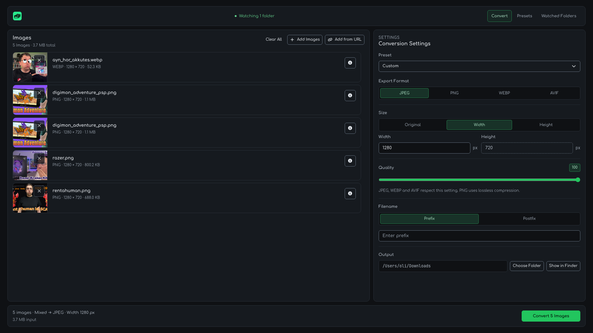
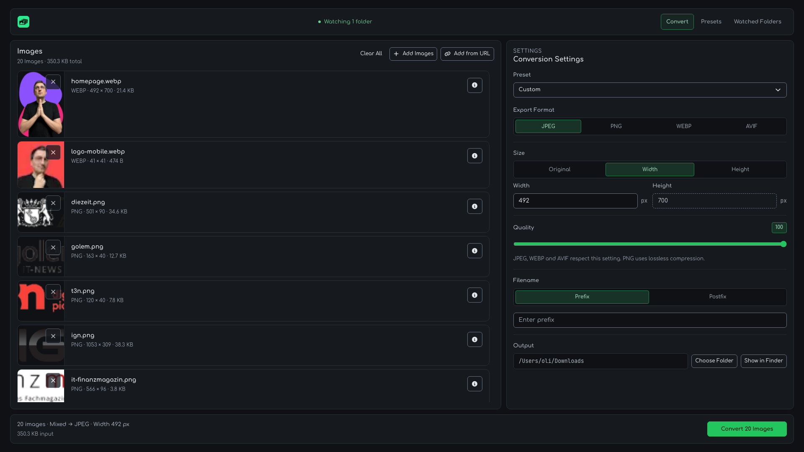
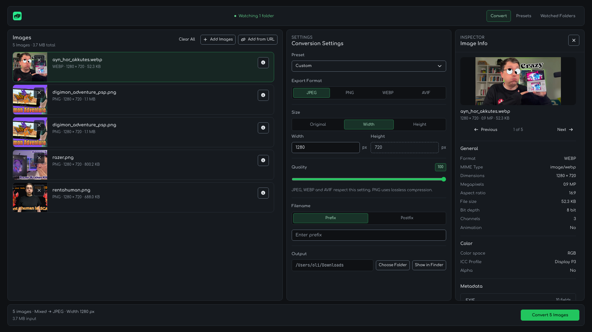
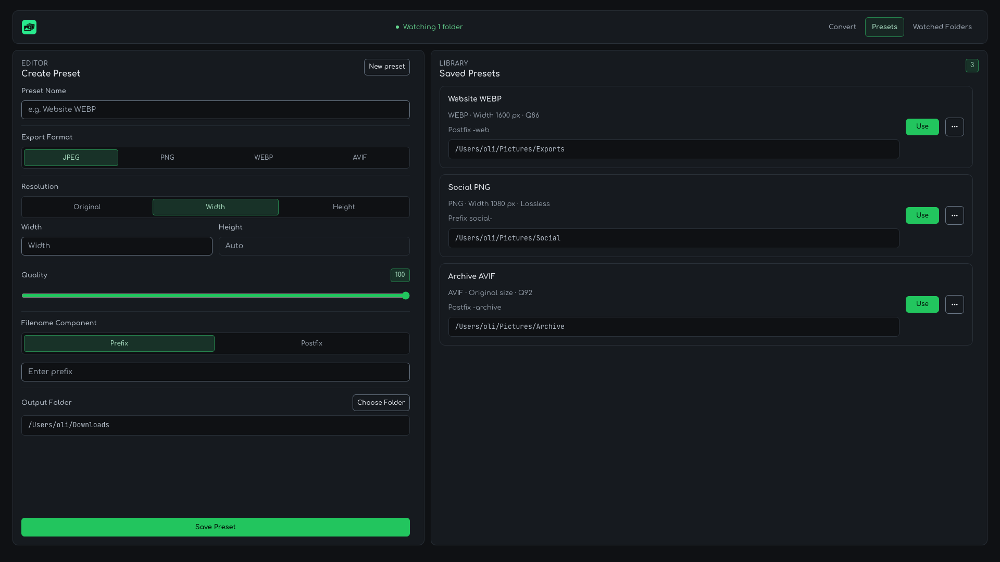
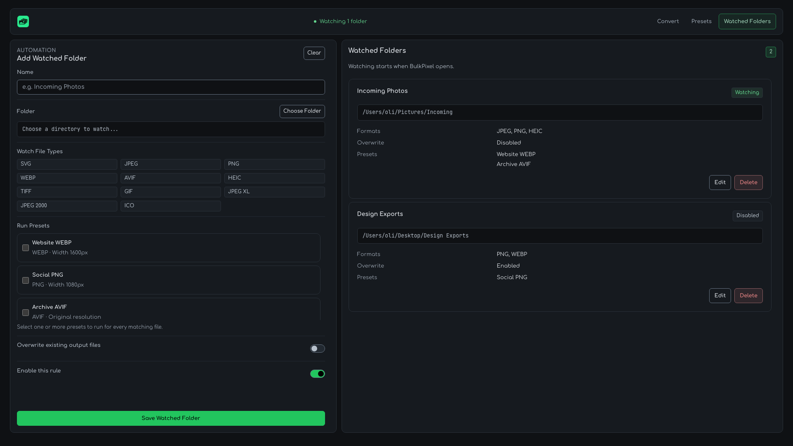
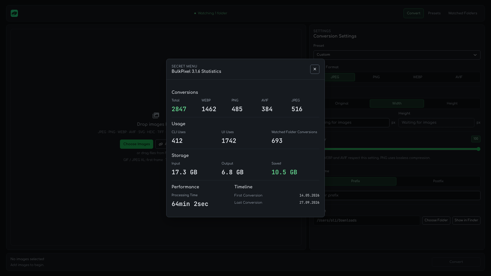

<p align="center">
  
</p>

# BulkPixel 🖼️

[](https://github.com/oliverjessner/BulkPixel/actions/workflows/dependabot/dependabot-updates)

BulkPixel is a batch image converter for macOS.<br>
It converts and resizes whole batches so you can skip editing each image by hand.<br>
All image conversion runs locally on your Mac.



Drop images from Finder into the queue or import them from a website. Choose an export format, size and output folder, then convert the batch in one step. Save settings as a preset to prepare the next batch the same way.

## What it does

- Import JPEG, PNG, WebP, AVIF, SVG, HEIC/HEIF, TIFF, GIF, JPEG XL, JPEG 2000 and ICO images.
- Export batches to JPEG, PNG, WebP or AVIF.
- Resize by width or height while keeping aspect ratios, and control JPEG, WebP and AVIF quality.
- Add filename prefixes or postfixes and choose where exports are saved.
- Download images from public image and website URLs, or send images from your browser.
- Inspect dimensions, color information and embedded metadata.
- Create, edit, duplicate and reuse presets, and apply them automatically with Watched Folders.
- Review conversion totals, processing time and file size savings.

See the [supported import and export formats](docs/FORMATS.md) for the compatibility matrix and format-specific behavior.

## Install

Available for macOS on Apple Silicon (M1 or newer).

### Homebrew

```sh
brew tap oliverjessner/tap
brew install --cask bulkpixel
```

### Download

Download the DMG from the [latest GitHub release](https://github.com/oliverjessner/BulkPixel/releases/latest), open it and drag **BulkPixel.app** to **Applications**.

If macOS cannot verify the developer on first launch, follow [Apple's instructions for opening the app](https://support.apple.com/en-us/102445) through **System Settings > Privacy & Security > Open Anyway**.

## CLI

Homebrew also installs the `bulkpixel` command for batch conversion, preset and Watched Folder management, and statistics.

```sh
bulkpixel convert \
  --input ./photo.jpg ./screenshot.png \
  --output-dir ./exports \
  --format webp --width 1200 --quality 85
```

See the [CLI documentation](docs/CLI.md) for all commands and options.

## Import from websites and your browser

Use **Add from URL** to paste image or website URLs and load their images into the queue, with progress, cancellation and retry for failed downloads. The bundled extension adds **Send to BulkPixel** to image context menus in Chrome, Chromium, Brave and Edge; follow the [browser setup guide](docs/BROWSER.md) to connect it.



## Inspect images before exporting

Open **Image Info** for a loaded image to check its dimensions, format, color information and available embedded metadata. Browse the images in your queue without leaving the conversion view.



## Choose size, quality and filenames

Set a width or height, adjust export quality and choose a filename prefix or postfix. Existing files are kept by default: the desktop app adds numbered suffixes for name collisions, and the CLI requires `--overwrite` to replace an existing file.

## Reuse conversion presets

Save the format, size, quality, filename settings and output folder together, then select the preset for your next batch. Edit, duplicate or delete saved setups as your needs change.



## Automate with Watched Folders

Choose a folder, input formats and one or more presets to convert matching files as they arrive while BulkPixel is running. Each rule lets you enable or disable automatic conversion and choose whether existing output files can be overwritten.



## Review conversion savings

Click the BulkPixel logo in the header to see conversion totals, storage savings, processing time and activity dates. The same statistics are available in Terminal with `bulkpixel stats`.



## Who it is for

- Bloggers and journalists preparing images for articles.
- Designers exporting previews and web assets.
- App developers preparing image assets and screenshots.
- Content creators processing batches of thumbnails and photos.

## Changelog

See the [changelog](docs/changelog.md) for release notes and changes.

## License

MIT
